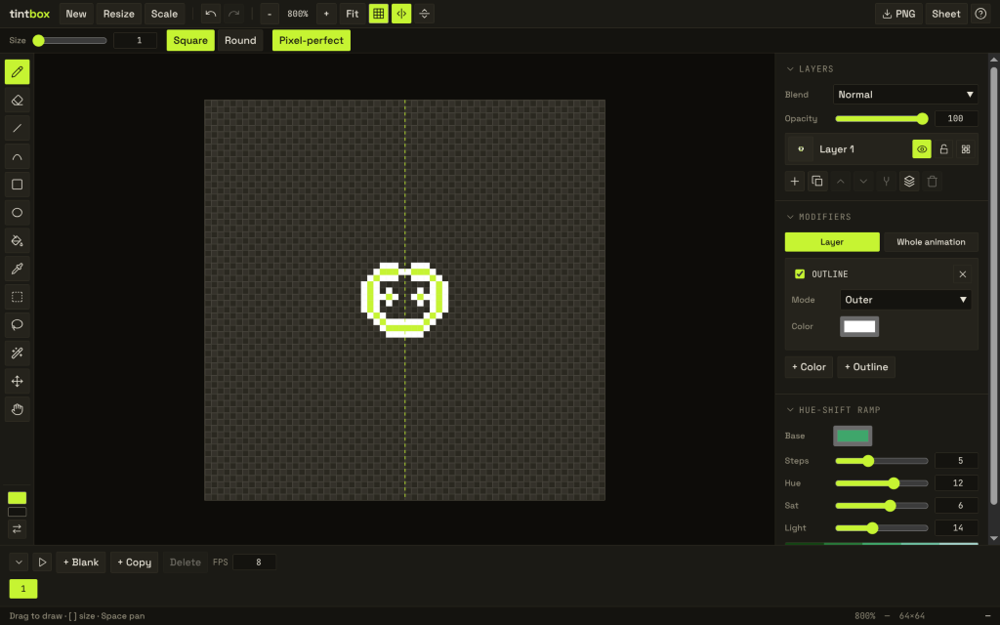
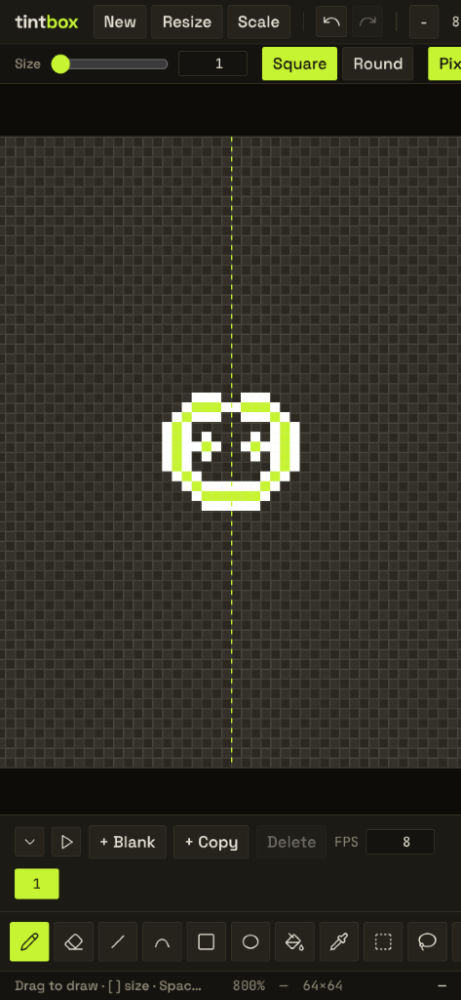

# Phase 1 Report — Core Editor

Date: 2026-11-26

## Shipped

### Architecture & P0 Gap Fixes
- Enforced layering `core <- state <- ui` and `core <- io` (`src/core/architecture.test.ts` greps imports, DOM globals, `any`, `@ts-ignore`, `console.log`).
- Replaced sequential `uid()` counter with `crypto.randomUUID()`; removed legacy `src/core/history.ts`; moved PNG/sheet export + `localStorage` UI prefs to `src/io/export.ts`.
- Added typed errors (`TintboxError`, `ValidationError`, `LayerLockedError`, `BoundsError`) in `src/core/errors.ts`.
- Fixed minor spec contradictions across `docs/FEATURES.md`, `docs/ARCHITECTURE.md`, and `docs/BUILD-PLAN.md`, logged in `docs/DECISIONS.md`.

### Undo / Redo Command Pattern (FEATURES sec. 4)
- Rewrote history in `src/state/history.ts` + `src/state/commands.ts` using sparse dirty-rect pixel diffs (`src/core/diff.ts`).
- Covered every document mutation: pixel edits, selection changes, layer add/duplicate/delete/reorder/rename/visibility/lock/alphaLock/opacity/blend/mergeDown/flattenVisible, frame add/duplicate/delete, modifier add/remove/toggle/param edits (coalesced per slider drag), canvas resize/scale.
- Enforces max 200 steps and max 128 MB diff memory (evicts oldest), ignores undo during active strokes, restores active layer/frame, exposes Undo/Redo tooltips with labels + `aria-live="polite"` announcements.
- Verified with byte-identical do/undo/redo round-trips for every command type and a 1,000-random-command undo-all fuzz test.

### Viewport, Integer Zoom & Canvas (F-ZOOM, F-CANVAS)
- Strict integer zoom ladder `[1, 2, 3, 4, 6, 8, 12, 16, 24, 32, 48, 64]` with cursor-anchored wheel/pinch zoom (`±0 px` drift), `+`/`-`/`1`/`0` keyboard zoom, pan clamping (`>= 32px` visible), Space+drag / middle-mouse / Hand (`H`) / two-finger touch pinch & pan, and center-preserving resize (`ResizeObserver`).
- Dual-canvas renderer (`src/ui/stage.ts`): document-resolution `<canvas>` (`image-rendering: pixelated`) + screen-resolution overlay `<canvas>` for crisp 1px pixel grid (`zoom >= 8`, 12% ink alpha, `#` toggle), marching ants selection (respecting `prefers-reduced-motion`), draggable symmetry axis, and pixel-snapped brush outline (`zoom >= 4`).
- New Document (presets 16–256, range 1–1024, transparent bg), Resize Canvas (9-point anchor, undoable), and Scale Canvas (nearest-neighbor, undoable) via native `<dialog>` (`showModal()`).

### Drawing, Selection, Move & Symmetry Tools (FEATURES sec. 2)
- `Tool` interface in `src/ui/tools.ts` with `PointerEvent.getCoalescedEvents()`, `setPointerCapture`, `pointercancel`, and `rAF` coalescing.
- Pencil (`B`) & Eraser (`E`): 1–32px square/round brush (`[` `]` keys), true stroke-level `StrokeTracker` pixel-perfect L-corner removal at size 1.
- Line (`L`, Shift 15° snap), Curve (`C`), Rectangle (`U`), Ellipse (`O`, Zingl-Bresenham midpoint algorithm, Shift square/circle, Alt from center, outline/filled).
- Bucket (`G`): 32-bit scanline flood fill with contiguous/global, layer/composed sample source, tolerance, mask, and alpha lock.
- Selection: 1-bit-per-pixel mask (`src/core/selection.ts`), Rect (`M`), Lasso (`Q`), Magic Wand (`W`), replace/add/subtract/intersect modes, `Ctrl+A/D/I`, `Ctrl+C/X/V` floating paste (`Enter` commit, `Esc` cancel), undoable.
- Move (`V`): drags floating paste, selection, or whole cel; arrow keys nudge 1px; wrap-around toggle.
- Symmetry: Mirror X / Y / XY with exact odd and even width/height mirroring (`src/core/symmetry.ts`) and draggable half-pixel axis.

### Layers & Workbench UX (FEATURES sec. 3 & 10, UX-DESIGN)
- Full layer model (`kind`, `visible`, `locked`, `alphaLock`, `opacity`, `blend: normal|multiply|screen|overlay|add`), 32px nearest-neighbor thumbnails, double-click rename, drag + button reorder, merge down (bakes modifiers, warns once), flatten visible, disabled delete on last layer, `"Layer locked"` toast.
- Single keyboard map (`src/ui/keymap.ts`) + `?` shortcuts dialog; Lucide 16px inline SVG icons; sliders paired with numeric inputs (`Shift+Arrow` x10); collapsible panels persisted in `localStorage`; responsive desktop (`>= 1024px`), tablet drawer (`600–1023px`), and phone bottom-bar/sheet (`< 600px`, stage 73% viewport height, zero horizontal overflow at `320px`).

## Cuts / Known Issues
- None within P1 scope.
- Browser tab limitation (logged in `docs/DECISIONS.md`): browsers reserve `Ctrl+N` in non-PWA tabs; `Alt+N` and the top bar `New` button provide full access.

## Verification & Metrics

### `npm run check`
- `tsc --noEmit`: 0 errors
- `vitest run`: 10/10 test files, 59/59 tests passed (includes core unit tests, golden-coordinate checks, command round-trips, 1,000-command fuzz test, architecture boundary test, perf budgets, and jsdom UI smoke tests)
- `vite build`: 32 modules transformed, `dist/assets/index-*.js` = **91.01 kB** (**29.19 kB gzip**)

### Coverage (`core/` + `state/`)
- Total lines: **95.87%** (`core/`: **95.01%**, `state/`: **98.41%**) — exceeds `>= 90%` requirement.

### Performance vs Budgets (`docs/ARCHITECTURE.md`)
| Case | Budget | Measured | Status |
|---|---|---|---|
| 64×64 stroke per pointer event | < 4 ms | **0.006 ms** | Pass |
| 256×256 compose (8 layers + 3 modifiers) | < 12 ms | **4.43 ms** | Pass |
| 1024×1024 flood fill | < 100 ms | **14.92 ms** | Pass |
| Cold load JS (gzip, excl. fonts) | < 200 KB | **29.19 KB** | Pass |

### Manual Script & UX Checklist
- Draw 50 strokes -> corner zoom (`3x -> 12x`, ±0 px anchor) -> undo 50x -> redo 50x -> byte-identical document: **Pass** (automated in `src/core/perf.test.ts` + interactive live check).
- Squint test, `:focus-visible` keyboard Tab traversal, 320px narrow width (0 horizontal overflow), banned slop audit, 0 console errors: **Pass**.

## Screenshots
- Desktop (1280×800): 
- Phone (375×812): 
