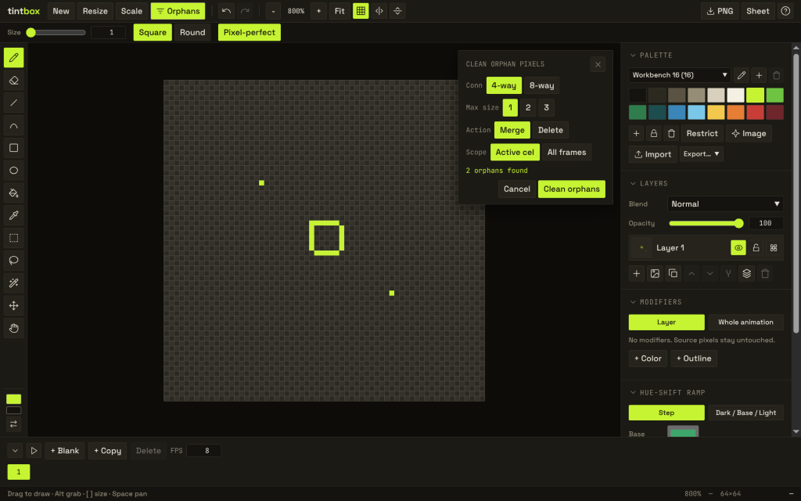
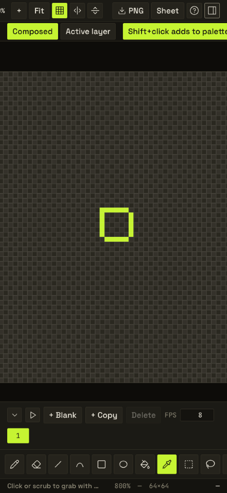

# Phase 2 Report — Color Tools

Date: 2026-11-26

## Shipped

### F-PALETTE: Palette Panel & Import/Export
- Stored `Doc.palettes[]` and `Doc.activePaletteId` in `src/core/types.ts` + `src/core/doc.ts` with a default 16-color workbench palette.
- Every palette operation is an undoable Command (`src/state/commands.ts`): create/delete/rename/switch palette, append/replace colors, remove swatch, drag-reorder swatches, and toggle swatch lock (locked swatches cannot be deleted and are preserved on palette replace).
- Click swatch sets primary, right-click or Alt+click sets secondary; `"Restrict"` toggle snaps incoming drawing colors to the nearest active palette entry in OKLab (`src/core/color.ts`).
- Pure parsers/serializers (`src/core/palette-format.ts`) + file I/O (`src/io/palette-io.ts`) for `.gpl` (GIMP), `.hex`, `.pal` (JASC), and `.png` strips (import + export `.gpl`, `.hex`, `.png`).

### F-GRAB: Color Grabber with Loupe & Alt-Grab
- Tool `I` plus hold-`Alt` temporary grabber across drawing tools (`pencil`, `eraser`, `line`, `curve`, `rect`, `ellipse`, `fill`).
- Crisp 96×96 px magnified 8×8 pixel loupe on the overlay canvas (`imageSmoothingEnabled = false`, checkerboard for transparent cells, 1px `--accent` center box, hex bar). Transparent pixels leave primary color unchanged.
- Sample source toggle (`Composed` | `Active layer`), `Shift+click adds to palette` toggle, reference image layer sampling (`sampleDocColor`), and feature-detected native `EyeDropper` API button (hidden if unsupported).

### F-EXTRACT: Palette from Reference Image
- Pure deterministic quantizer in `src/core/quantize.ts`: `extractPalette` (downscales longest side to 256px nearest-neighbor; methods `median-cut`, farthest-point seeded `kmeans-oklab` max 12 iterations, `most-frequent`; luminance or hue sort; ignore transparent always + optional ignore near-white/near-black; exact N colors or unique count with message) and `remapToPalette` (OKLab nearest + optional 4×4 Bayer ordered dither).
- Native `<dialog>` (`Palette > Image`): file picker, drag-drop, clipboard paste, live preview, segmented `4 / 8 / 16` presets + custom `2..64`, live swatches with `%` pixel coverage, and actions **Replace palette**, **Append**, **New palette**, **Recolor canvas** (undoable).
- Untrusted image security (`src/io/image.ts`): `createImageBitmap`, max 4096 px/side, max 64 MP, max 50 MB.

### F-REF: Reference Image Layer
- Import via Layers `+ Ref` button, stage drag-and-drop, or clipboard paste.
- Excluded from `compose()` and all exports; drawing tools refuse with `"Reference layer is not drawable."`; sampled by `F-GRAB`.
- Undoable transforms: drag with Move (`V`) or X/Y inputs, scale (`10–400%`), Smooth vs Nearest interpolation, Flip H / Flip V, opacity, lock, visibility, and 20 MB cumulative reference-size warning.

### F-ORPHAN: Orphan Pixel Remover
- Pure `Uint32Array` BFS engine in `src/core/cleanup.ts`: `findOrphans` & `removeOrphans` supporting 4/8 connectivity, min cluster size 1/2/3, Merge (most frequent non-orphan neighbor, tie-break by lowest Rec.709 luminance diff; isolated floating specks set transparent for strict idempotency, logged in `docs/DECISIONS.md`) or Delete, selection/cel/all-frames scope.
- Floating workbench cleaner panel with live 1px `--accent` (magenta-free) highlights, live count (`"N orphans found"`), `Esc` cancel, and single undo step (including `multiFramePixelPatchCommand` across frames).

### F-RAMP: Hue-Shift Ramp Extensions
- Added `Step | Dark / Base / Light` HSL + multiplier (50–200%) mode (`makeTriadRamp`), `Lock to palette` (OKLab snap), and `Send to palette` (undoable append).

## Cuts / Known Issues
- None within P2 scope. (Palette usage pixel-count badges are explicitly P3 per `docs/FEATURES.md`.)
- Fixed a browser-QA-caught bug where `#stage`'s `pointerdown`/`wheel` capture intercepted mouse clicks on the floating `.orphan-panel` child; verified fixed in live browser.

## Verification & Metrics

### `npm run check`
- `tsc --noEmit`: 0 errors
- `vitest run`: 13/13 test files, 80/80 tests passed
- `vite build`: `dist/assets/index-DVcPjwhW.js` = **137.43 kB** (**43.42 kB gzip**)

### Coverage (`core/` + `state/`)
- Total lines: **94.83%** (`core/`: **93.56%**, `state/`: **98.77%**) — exceeds `>= 90%` requirement.

### Performance vs Budgets (`docs/ARCHITECTURE.md`)
| Case | Budget | Measured | Status |
|---|---|---|---|
| Palette extract, 1024px image, 16 colors (median-cut) | < 300 ms | **47.08 ms** | Pass |
| Palette extract, 1024px image, 16 colors (K-means OKLab) | < 300 ms | **104.57 ms** | Pass |
| Orphan scan 512×512 | < 50 ms | **14.98 ms** | Pass |
| Cold load JS (gzip, excl. fonts) | < 200 KB | **43.42 KB** | Pass |

### Live Browser QA & UX Checklist
- Desktop (`1280×800`) & Phone (`375×812`): 0 console errors, 0 horizontal overflow, phone stage 73.0% (>= 50%), Palette panel + Extract dialog + Loupe grabber + Orphan cleaner mouse/keyboard + drawer sheet all pass.

## Screenshots
- Desktop (1280×800): 
- Phone (375×812): 
