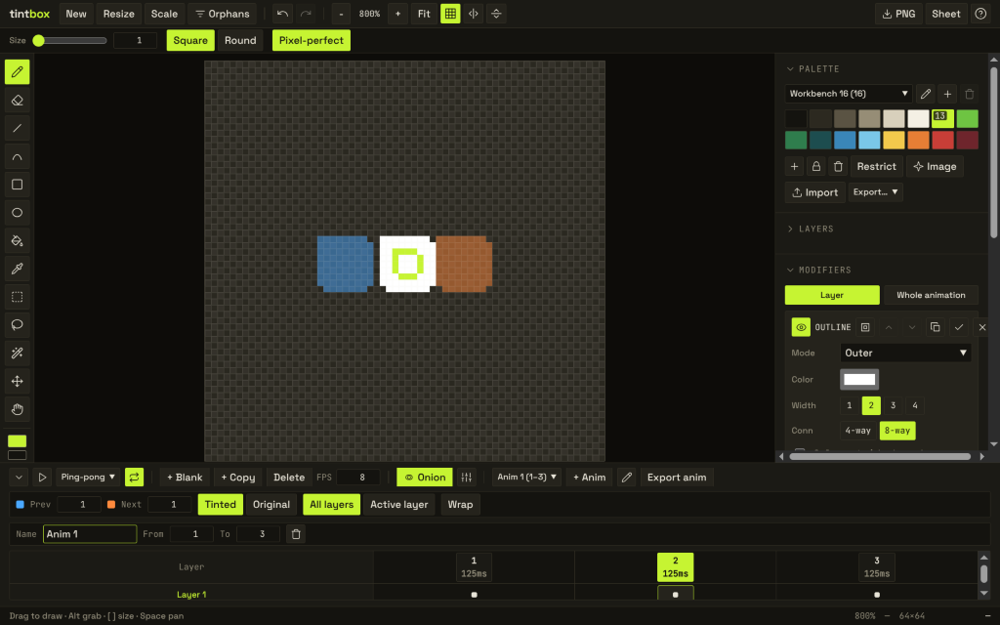
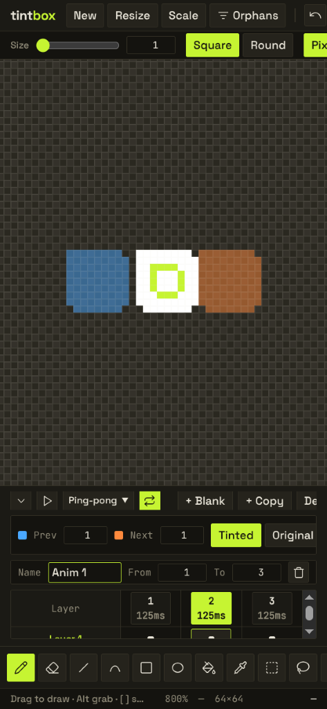

# Phase 3 Report — Animation

Date: 2026-11-26

## Shipped

### Timeline, Frame Durations & Named Animations (FEATURES sec. 6)
- Upgraded `Doc.frames` to `Frame[]` (`{ id, duration }`) and added `Doc.animations: Animation[]` (`{ id, name, from, to, direction, loop }`) in `src/core/types.ts` + `src/core/doc.ts`.
- Pure animation & playback module in `src/core/animation.ts`: `resolvePlaybackRange`, `buildPlaybackSequence` (`forward` | `reverse` | `pingpong`), `stepPlayback`, `frameDurationMs`, `clampAnimationsToFrameCount`.
- Built dedicated Layers × Frames timeline matrix (`src/ui/timeline.ts`):
  - Click any `(layer, frame)` cel cell to select both; filled dot indicates non-empty cel.
  - Frame headers display frame number + duration (`125ms`); double-click inline-edits duration (undoable `setFrameDurationCommand`); drag-and-drop reorders frames keeping all layer cels aligned (undoable `reorderFrameCommand`).
  - Real-clock `performance.now()` + `requestAnimationFrame` delta-accumulator playback (zero `setInterval` drift), supporting `forward`, `reverse`, `pingpong`, and `loop`.
  - Named animations dropdown (`All frames` + named animations), `+ Anim`, inline name/range/delete editor (undoable), and per-animation PNG spritesheet export (`Export anim`).

### F-ONION: Onion Skin
- Shortcut `N` + timeline Onion toggle + inline settings bar persisted in `localStorage`:
  - Frames before (`0–5`, default `1`) and after (`0–5`, default `1`), linear opacity falloff starting at `50%`.
  - Mode: `Tinted` (`--onion-prev` `#4aa8ff`, `--onion-next` `#ff8a3d` with visible color swatches) or `Original`.
  - Source: `All layers` (composed visible) or `Active layer` (`composeLayerOnly`).
  - `Wrap` toggle across active animation range (on frame 1, previous frame shows only when wrap is enabled).
- Rendered on dedicated `onion-canvas` above checkerboard and below current frame `doc-canvas`; hidden during playback; excluded from `compose()`, thumbnails, and exports (verified by export equality tests).

### Modifier Extensions (FEATURES sec. 7)
- Pure `src/core/modifiers.ts` extended without ever mutating source cel bytes:
  - Outline `width` (`1..4`), `connectivity` (`4 | 8`), and `onlyOutsideBounds` (default `false`, logged in `docs/DECISIONS.md`).
  - Optional `mask?: SelectionMaskData` on any modifier (`Mask` toggle binds current selection slice).
  - Non-destructive `soloModifierId` support: hold `Alt` on the modifier eye button to solo-preview it without mutating `Doc`.
- Undoable modifier commands (`src/state/commands.ts`): drag-and-drop + button reorder (`reorderModifierCommand`), duplicate (`duplicateModifierCommand`), and destructive bake to pixels via right-click header or Apply button (`bakeModifierCommand`).

### Palette Usage Counts & History Panel
- `countPaletteUsage(composed, palette)` (`src/core/animation.ts`) displays live pixel count badges on active palette swatches in `src/ui/panels.ts`.
- Extended `History` (`src/state/history.ts`) with `getEntries()` and `jumpTo(index)` powering the collapsible **History** panel in the right sidebar.

## Cuts / Known Issues
- None within P3 scope. (Per-layer frame counts are P6 per `docs/FEATURES.md`; Drop shadow / Palette map modifiers are P4.)

## Verification & Metrics

### `npm run check`
- `tsc --noEmit`: 0 errors
- `vitest run`: 14/14 test files, 90/90 tests passed (including animation playback, onion wrap/opacity/export equality, modifier width/8-conn/mask/solo/bake, command round-trips, and jsdom UI smoke tests)
- `vite build`: `dist/assets/index-DLz7lB_W.js` = **160.14 kB** (**49.74 kB gzip**)

### Coverage (`core/` + `state/`)
- Total lines: **94.71%** (`core/`: **93.15%**, `state/`: **98.87%**) — exceeds `>= 90%` requirement.

### Performance vs Budgets (`docs/ARCHITECTURE.md`)
| Case | Budget | Status |
|---|---|---|
| 64×64 stroke per pointer event | < 4 ms | Pass (`perf.test.ts`) |
| 256×256 compose (8 layers + 3 modifiers) | < 12 ms | Pass (`perf.test.ts`) |
| 1024×1024 flood fill | < 100 ms | Pass (`perf.test.ts`) |
| Palette extract 1024px (16 colors) | < 300 ms | Pass (`perf.test.ts`) |
| Orphan scan 512×512 | < 50 ms | Pass (`perf.test.ts`) |
| Cold load JS (gzip, excl. fonts) | < 200 KB | **49.74 KB** Pass |

### Live Browser QA & UX Checklist
- Desktop (`1280×800`) & Phone (`375×812`): 0 console errors, 0 horizontal overflow, phone stage 60.1% (>= 50%), status bar flush. Verified Layers × Frames matrix, blue/orange onion ghosts under Frame 2, onion hidden during real-clock playback, named Ping-pong animation, 2px 8-way Outline modifier, palette usage badge (`13`), and History panel.

## Screenshots
- Desktop (1280×800): 
- Phone (375×812): 
