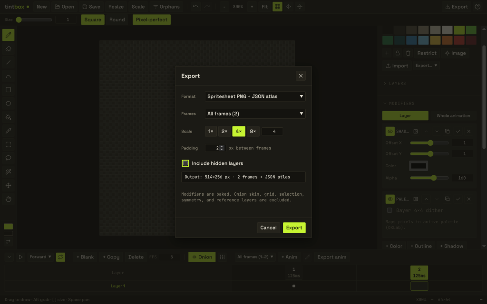
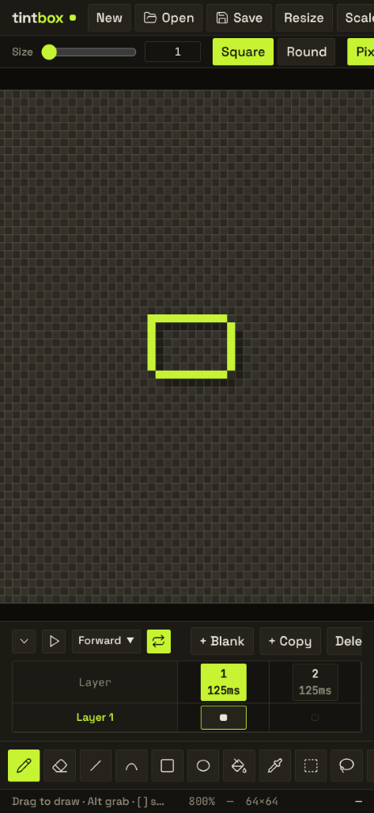

# Phase 4 Report — Persistence, Export, P4 Modifiers & Offline PWA

## Shipped
- **`.tintbox` project archive & schema migrations** ([project.ts](file:///mnt/Data/Newshi/tintbox/src/core/project.ts), [png.ts](file:///mnt/Data/Newshi/tintbox/src/io/png.ts), [project-io.ts](file:///mnt/Data/Newshi/tintbox/src/io/project-io.ts)):
  - Pure straight-alpha 8-bit RGBA PNG codec (`encodePngRgba` / `decodePngRgba`, all 5 scanline filters, CRC32) eliminating premultiplied-alpha loss across Node and browsers.
  - `.tintbox` zip archive (`fflate`) packing `project.json` + `cels/<layerId>_<frame>.png` + `refs/<layerId>.png`.
  - Schema `version: 1` with strict bounds/type validation (<= 50 MB, <= 4096 px/side) and v0 -> v1 migration verified against fixtures ([project-v0.json](file:///mnt/Data/Newshi/tintbox/test/fixtures/project-v0.json), [project-v1.json](file:///mnt/Data/Newshi/tintbox/test/fixtures/project-v1.json)).
  - Manual Save (`Ctrl+S`) / Open (`Ctrl+O`) using File System Access API when available with standard download / `<input type="file">` fallback; corrupt archives leave the active document untouched and display an error toast.
- **IndexedDB autosave & unsaved-changes guard** ([autosave.ts](file:///mnt/Data/Newshi/tintbox/src/io/autosave.ts), [controller.ts](file:///mnt/Data/Newshi/tintbox/src/ui/controller.ts), [dialogs.ts](file:///mnt/Data/Newshi/tintbox/src/ui/dialogs.ts), [app.ts](file:///mnt/Data/Newshi/tintbox/src/ui/app.ts)):
  - Automatic draft save to IndexedDB (`tintbox-autosave` / `drafts`) every 10 s after dirty changes; cleared on explicit save or new document.
  - Native `<dialog>` recovery prompt on reload (`Discard` / `Recover draft`) with saved timestamp.
  - Dirty state dot (`•` in brand + page title) and `beforeunload` warning when unsaved edits exist.
- **Export dialog & encoders** ([export-pack.ts](file:///mnt/Data/Newshi/tintbox/src/io/export-pack.ts), [gifenc.d.ts](file:///mnt/Data/Newshi/tintbox/src/io/gifenc.d.ts), [dialogs.ts](file:///mnt/Data/Newshi/tintbox/src/ui/dialogs.ts)):
  - Native `<dialog>` (`Ctrl+E` or top-bar `Export`):
    - **PNG (single frame)**: lossless straight-alpha PNG.
    - **Animated GIF** (`gifenc`): honors exact per-frame durations (`ms` -> GIF centiseconds), global palette only (local tables off), single transparent index (`dispose: 2`), dither off, configurable loop.
    - **Spritesheet PNG + JSON atlas**: horizontal strip with configurable inter-frame padding (`0–64 px`) and structured JSON atlas (`meta`, `frames`, `animations`).
    - **PNG sequence (`.zip`)**: numbered `frame_001.png`... archive via `fflate`.
  - Nearest-neighbor integer scaling (`1×–16×`, presets `1×/2×/4×/8×`), scope selector (active frame, all frames, or any named animation including `pingpong` expansion), `Include hidden layers` toggle, live output dimensions summary.
  - Modifiers always baked; onion skin, grid, selection, symmetry guides, and reference layers always excluded.
- **P4 Modifiers** ([modifiers.ts](file:///mnt/Data/Newshi/tintbox/src/core/modifiers.ts), [doc.ts](file:///mnt/Data/Newshi/tintbox/src/core/doc.ts), [commands.ts](file:///mnt/Data/Newshi/tintbox/src/state/commands.ts), [panels.ts](file:///mnt/Data/Newshi/tintbox/src/ui/panels.ts)):
  - **Drop shadow** (`offsetX`, `offsetY`, `color`, `alpha`, selection mask, undoable + bakeable).
  - **Palette map** (maps to active palette in OKLab with optional Bayer 4×4 dither, selection mask, undoable + bakeable).
- **Offline PWA** ([manifest.webmanifest](file:///mnt/Data/Newshi/tintbox/public/manifest.webmanifest), [sw.js](file:///mnt/Data/Newshi/tintbox/public/sw.js), [icon.svg](file:///mnt/Data/Newshi/tintbox/public/icon.svg), [index.html](file:///mnt/Data/Newshi/tintbox/index.html), [main.ts](file:///mnt/Data/Newshi/tintbox/src/main.ts)):
  - Standalone manifest + SVG icon + production Service Worker (`tintbox-shell-v1`) precaching app shell and caching same-origin Vite hashed assets for offline reload.

## Cuts / Limitations
- Live browser QA ran inside `webview_browser` (which does not expose `context.setOffline(true)` / `page.evaluate`), so `/manifest.webmanifest` (HTTP 200), `/sw.js` (HTTP 200), and production bundle registration were verified while true offline reload toggle should be spot-checked in a desktop Chromium/Firefox window.

## Known Bugs
- None open. Visual QA caught and fixed three CSS issues during verification (`[hidden] { display: none !important; }` hiding inactive Export/Timeline bars, `.brand` nowrap keeping `.dirty-dot` inline on `375px` phones, and `.mod header span` ellipsis preventing wrap on `PALETTE-MAP`).

## Verification (`npm run check` & Coverage)
```text
npm run check -> tsc --noEmit && vitest run && vite build
Test Files  17 passed (17)
Tests       108 passed (108)
Duration    5.49s

dist/index.html                0.54 kB │ gzip:  0.34 kB
dist/assets/index-DD7zRxRo.css 29.20 kB │ gzip: 12.02 kB
dist/assets/index-CymkbK-A.js 211.93 kB │ gzip: 68.67 kB
✓ built in 350ms
```

Coverage (`src/core/**` + `src/state/**`):
- **All files**: **94.79%** lines (target `>= 90%`)
- `core/`: **93.23%** lines (`project.ts`: 94.87%)
- `state/`: **99.36%** lines (`commands.ts`: 99.62%, `ui.ts`: 100%)

## Performance vs Budgets
| Metric | Budget | Measured | Status |
|---|---|---|---|
| Initial JS gzip (excl. fonts) | < 200 KB | **68.67 KB** (`fflate` + `gifenc` included) | PASS |
| CSS gzip | — | 12.02 KB | PASS |
| `perf.test.ts` suite (6 benchmarks) | All budgets | 6/6 PASS (505 ms total) | PASS |
| `.tintbox` round-trip (`io.test.ts`) | Byte-identical | Byte-identical cels + refs + modifiers + animations | PASS |
| GIF timing (`io.test.ts`) | Exact frame count & durations | `[5, 12, 35]` cs for `[50, 120, 350]` ms, 0 local tables | PASS |
| Live QA console / page errors | 0 | **0** | PASS |

## Screenshots
- **Desktop (`1280×800`)** — Export dialog (`Spritesheet PNG + JSON atlas`, 4× scale, 2px padding), Shadow + Palette-map modifiers, dirty indicator, 2-frame timeline:
  
- **Phone (`375×812`)** — Inline `tintbox •`, Open/Save top controls, lime square with Drop Shadow modifier on 68% viewport stage, compact timeline & bottom tool rail:
  
