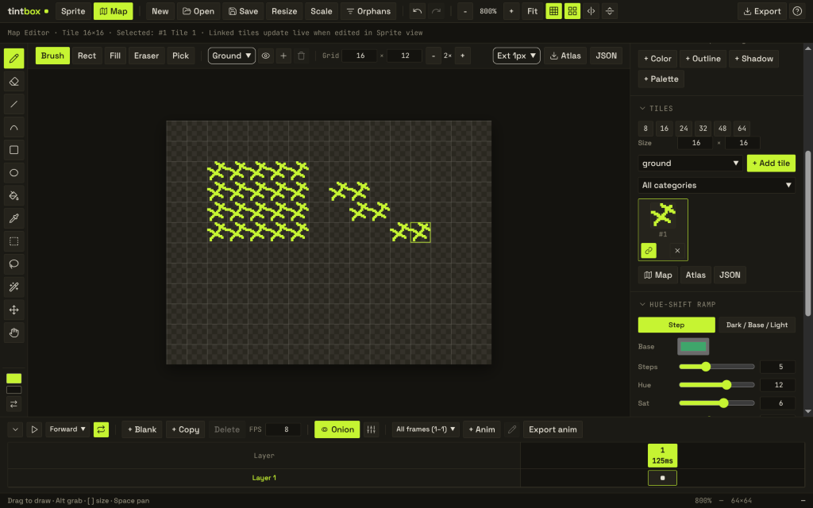
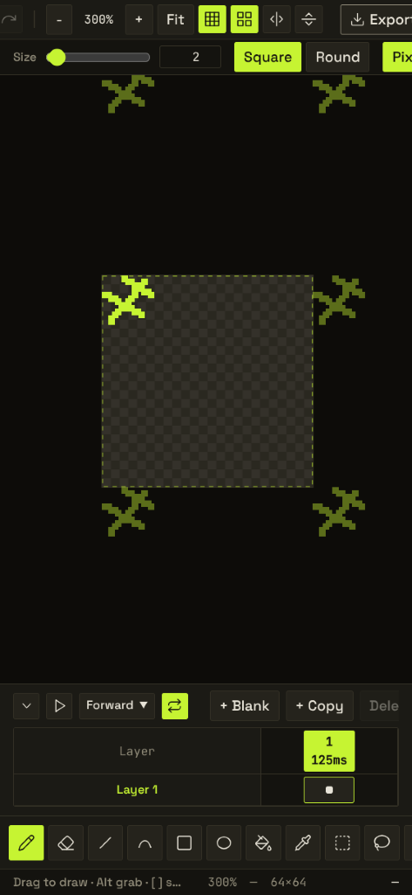

# Phase 5 Report — Tiles (Repeat Tile Mode, Tile Builder & Map Editor)

## Shipped
- **Repeat Tile Mode (`F-TILEMODE`)** ([tiles.ts](file:///mnt/Data/Newshi/tintbox/src/core/tiles.ts), [raster.ts](file:///mnt/Data/Newshi/tintbox/src/core/raster.ts), [tools.ts](file:///mnt/Data/Newshi/tintbox/src/ui/tools.ts), [stage.ts](file:///mnt/Data/Newshi/tintbox/src/ui/stage.ts), [keymap.ts](file:///mnt/Data/Newshi/tintbox/src/ui/keymap.ts)):
  - Keyboard shortcut `T` and top-bar toggle with `X`, `Y`, or `XY` wrap axes in the contextual options bar.
  - Stage renders 3×3 tiled copies at reduced opacity (`0.42`) around the center tile with a subtle dashed tile-boundary frame; never included in exports.
  - Pencil, Eraser, Line, Rect, Ellipse, Curve, and Bucket Fill wrap seamlessly across enabled tile edges (`wrapX` / `wrapY`).
- **Tile Builder** ([tiles.ts](file:///mnt/Data/Newshi/tintbox/src/core/tiles.ts), [commands.ts](file:///mnt/Data/Newshi/tintbox/src/state/commands.ts), [panels.ts](file:///mnt/Data/Newshi/tintbox/src/ui/panels.ts)):
  - Tile size presets (`8, 16, 24, 32, 48, 64`) and custom `W × H` (`1..256`), undoable via `setTileSizeCommand`.
  - Capture from active selection bounds (or canvas origin) via `+ Add tile` with category tagging (`ground`, `wall`, `prop`, `hazard`, `custom`) and category filtering.
  - Deterministic 64-bit FNV-1a pixel-hash + byte-equality deduplication: prevents duplicates, selects the existing tile, and shows an error toast warning.
  - Live **linked** tiles (`resolveTilePixels`): editing the source region on the sprite canvas immediately updates tile thumbnails, the Map Editor canvas, and exported PNG atlases; toggling unlink freezes a static snapshot (undoable).
- **Map Editor & Export** ([map-stage.ts](file:///mnt/Data/Newshi/tintbox/src/ui/map-stage.ts), [export-pack.ts](file:///mnt/Data/Newshi/tintbox/src/io/export-pack.ts), [app.ts](file:///mnt/Data/Newshi/tintbox/src/ui/app.ts)):
  - Dedicated `Sprite | Map` workbench toggle with snap-to-grid tile rendering, integer zoom (`1×–8×`), hover highlight, and tools: **Brush**, **Rect**, **Fill**, **Eraser**, **Pick-tile**.
  - Multiple map layers (add, delete, visibility toggle, active layer selector) and map grid `W × H` resize — every mutation is an undoable `Command` in `History`.
  - Map JSON export (`{ tileSize, tileWidth, tileHeight, width, height, layers: [{ name, visible, data }] }`) and Tileset PNG Atlas export with optional **`0`, `1`, or `2` px edge extrusion** (zero overlap, zero bleed at nearest sampling).
- **`.tintbox` schema `v2` persistence** ([project.ts](file:///mnt/Data/Newshi/tintbox/src/core/project.ts), [project-io.ts](file:///mnt/Data/Newshi/tintbox/src/io/project-io.ts)):
  - Packs `tiles/<id>.png` + `tileset` & `tilemap` metadata into `.tintbox` zip archives; migrates `v0 → v1 → v2` cleanly against existing fixtures.

## Cuts / Limitations
- None within Phase 5 scope. Phase 6 items (live vector paths, 3D blockout/UV painter, Tauri wrap, cloud sync) remain out of scope per `docs/BUILD-PLAN.md`.

## Known Bugs
- None open.

## Verification (`npm run check` & Coverage)
```text
npm run check -> tsc --noEmit && vitest run && vite build
Test Files  19 passed (19)
Tests       114 passed (114)

dist/index.html                0.54 kB │ gzip:  0.34 kB
dist/assets/index-GA2SyeYe.css 31.03 kB │ gzip: 12.30 kB
dist/assets/index-CMsGwIaY.js 239.44 kB │ gzip: 76.62 kB
✓ built in 349ms
```

Coverage (`src/core/**` + `src/state/**`, excluding `perf.test.ts`):
- **All files**: **94.64%** lines (target `>= 90%`)
- `core/`: **93.77%** lines (`tiles.ts`: **97.36%**, `project.ts`: **96.10%**, `raster.ts`: **97.51%**)
- `state/`: **96.99%** lines (`commands.ts`: **96.91%**, `ui.ts`: **100%**)

## Performance vs Budgets
| Metric | Budget | Measured | Status |
|---|---|---|---|
| Initial JS gzip (excl. fonts) | < 200 KB | **76.62 KB** | PASS |
| CSS gzip | — | 12.30 KB | PASS |
| `perf.test.ts` suite (6 benchmarks) | All budgets | 6/6 PASS (451 ms total) | PASS |
| Linked tile AC (`tiles.test.ts`) | Source edit updates map live | Verified byte-exact on composed map & unlinked freeze | PASS |
| Atlas extrusion AC (`tiles.test.ts`) | Zero overlap / zero bleed | Verified 2px extrusion cell boundaries & inner rects | PASS |
| Live QA console / page errors | 0 | **0** | PASS |

## Screenshots
- **Desktop (`1280×800`)** — Map Editor mode with 26 painted `#1` tile cells on `16×12` snap-to-grid canvas, Map toolbar (`Brush/Rect/Fill/Eraser/Pick`, `Ground` layer, `Ext 1px`, `Atlas`, `JSON`), and right-hand **Tiles** panel with linked tile `#1`:
  
- **Phone (`375×812`)** — Repeat Tile Mode (`XY`) active on Sprite canvas at `300%` showing 3×3 reduced-opacity tiled ghost copies around center tile, 68% viewport stage height, zero horizontal overflow:
  
