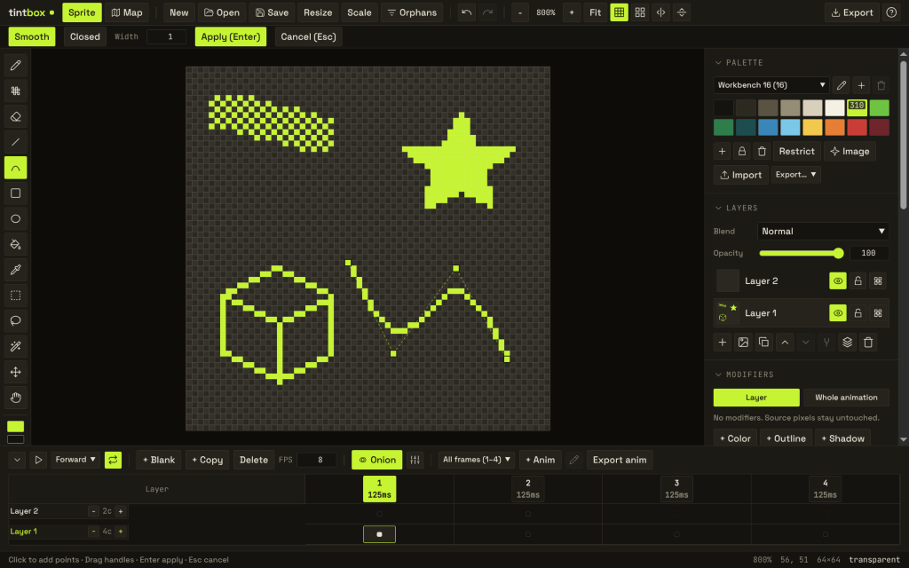
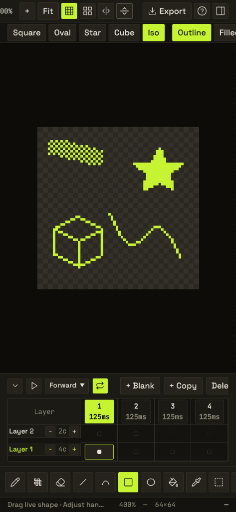

# Phase 6 Report — Advanced Pixel-Art Core Pack

Mini-specs appended to [FEATURES.md](file:///mnt/Data/Newshi/tintbox/docs/FEATURES.md) Section 11 before implementation per `docs/BUILD-PLAN.md`.

## Shipped
- **Dither Brush (`F-DITHER`, `D`)** ([dither.ts](file:///mnt/Data/Newshi/tintbox/src/core/dither.ts), [tools.ts](file:///mnt/Data/Newshi/tintbox/src/ui/tools.ts), [app.ts](file:///mnt/Data/Newshi/tintbox/src/ui/app.ts)):
  - Patterns: `Checker`, `Bayer 2×2`, `Bayer 4×4`, `Diagonal`, `Scanline` with adjustable density (`10–90%`), brush size `1..32`, and **Single** or **Dual color** (primary + secondary) mode.
  - Honors selection mask, alpha lock, symmetry, and Repeat Tile Mode edge wrap; commits as a single undo step.
- **Live Vector Paths (`F-VECTOR`, `C`)** ([shapes.ts](file:///mnt/Data/Newshi/tintbox/src/core/shapes.ts), [tools.ts](file:///mnt/Data/Newshi/tintbox/src/ui/tools.ts)):
  - Replaces one-shot Curve with editable multi-vertex paths: click to add points, drag any handle to reposition live, toggle **Smooth** (quadratic spline through midpoints) vs **Polyline**, **Closed** loop, and stroke width `1..8 px`.
  - Renders live rasterized pixel preview plus dashed control polygon and lime vertex handles on `overlayCanvas`; commits in 1 undo step on `Enter` / **Apply**, cancels on `Esc`.
- **Live Shape Presets (`F-SHAPES`, `U`/`O`)** ([shapes.ts](file:///mnt/Data/Newshi/tintbox/src/core/shapes.ts), [tools.ts](file:///mnt/Data/Newshi/tintbox/src/ui/tools.ts)):
  - Presets: `Square`, `Oval`, `Star` (`4..12` points), `Cube` (3-face pixel cube), and `Iso` (exact 2:1 pixel-art isometric diamond), Outline or Filled.
  - Post-drag live corner handles allow resizing or switching preset/fill/star points before committing (`Enter` / **Apply** / next drag) or canceling (`Esc`).
- **Per-Layer Frame Counts (`F-LAYERFRAMES`)** ([doc.ts](file:///mnt/Data/Newshi/tintbox/src/core/doc.ts), [project.ts](file:///mnt/Data/Newshi/tintbox/src/core/project.ts), [commands.ts](file:///mnt/Data/Newshi/tintbox/src/state/commands.ts), [timeline.ts](file:///mnt/Data/Newshi/tintbox/src/ui/timeline.ts)):
  - Independent cel loop length per pixel layer via `getLayerCel(layer, frame)` (`frame % layer.cels.length`) across compose, playback, onion skin, merge/flatten, and export.
  - Undoable `setLayerFrameCountCommand` wired to `- Nc +` controls in the Timeline matrix with `.loop-cel` styling on looped frames; preserved across `.tintbox` save/load.

## Deferred P6 Modules
- 3D blockout & UV painter (`three.js`), Tauri desktop wrap, and Cloud sync were explicitly deferred per user scope choice.

## Known Bugs
- None open.

## Verification (`npm run check` & Coverage)
```text
npm run check -> tsc --noEmit && vitest run && vite build
Test Files  20 passed (20)
Tests       121 passed (121)

dist/index.html                0.54 kB │ gzip:  0.34 kB
dist/assets/index-Bg6eBNIT.css 31.53 kB │ gzip: 12.40 kB
dist/assets/index-tea_NXC-.js 251.64 kB │ gzip: 80.15 kB
✓ built in 361ms
```

Coverage (`src/core/**` + `src/state/**`, excluding `perf.test.ts`):
- **All files**: **94.64%** lines (target `>= 90%`)
- `core/`: **93.80%** lines (`dither.ts`: **100%**, `shapes.ts`: **91.48%**, `tiles.ts`: **97.36%**, `project.ts`: **96.12%**)
- `state/`: **97.06%** lines (`commands.ts`: **96.99%**, `ui.ts`: **100%**)

## Performance vs Budgets
| Metric | Budget | Measured | Status |
|---|---|---|---|
| Initial JS gzip (excl. fonts) | < 200 KB | **80.15 KB** | PASS |
| CSS gzip | — | 12.40 KB | PASS |
| `perf.test.ts` suite (6 benchmarks) | All budgets | 6/6 PASS (386 ms total) | PASS |
| Live QA console / page errors | 0 | **0** | PASS |

## Screenshots
- **Desktop (`1280×800`)** — Checkerboard Dither swath, Filled Star, Outline Cube, active Live Vector Path with handles & `Apply (Enter)`, and 4-frame Timeline showing `Layer 2` at `2c` with looped frames:
  
- **Phone (`375×812`)** — Live Shape preset bar (`Square / Oval / Star / Cube / Iso`), committed P6 artwork at `400%` Fit (`64.5%` viewport height), Dither brush in bottom rail, `- 2c +` Timeline matrix, zero overflow:
  
